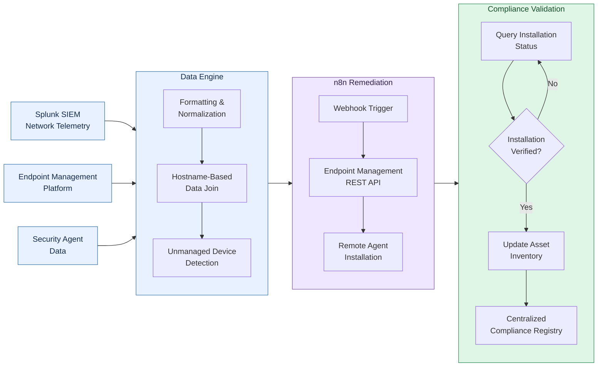
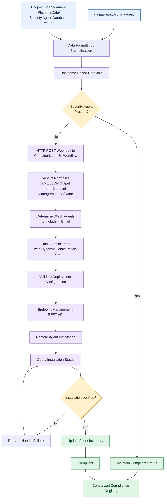
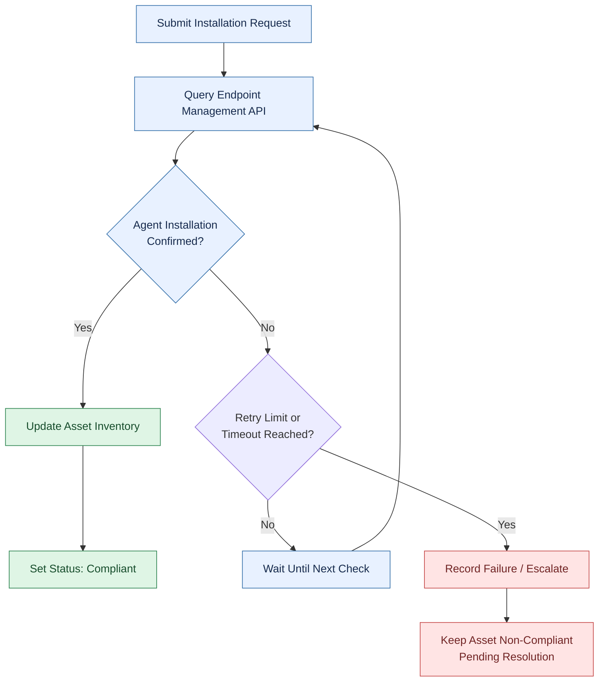

# C2C Pipeline: Automated Endpoint Compliance & Remediation

A closed-loop Comply-to-Connect (C2C) pipeline that finds active devices missing required security agents, routes them through an administrator-approved deployment, and marks them compliant only after the installation is verified through the endpoint management API.

## At a Glance

**Problem:** Our data was fragmented: network telemetry in Splunk, agent and compliance records in separate endpoint tools. Without a unified view, unmanaged machines were effectively invisible, and finding them meant manually correlating millions of log events against inventory records.

**What I built:** A pipeline that joins the datasets by hostname, flags devices without required agents, and triggers an n8n workflow that emails an administrator, deploys the agent through a REST API, validates until the install is confirmed, ending up being a continuous vetting cycle.

**Outcome:** Compliance checking moved from manual audits to a repeatable workflow. The IT staff no longer start each deployment by hand, and the asset inventory reflects verified installs instead of submitted requests.

### Skills demonstrated

Security engineering and endpoint compliance · SIEM querying (Splunk) · data correlation and normalization · workflow automation (n8n) · REST API integration · JSON/XML parsing and schema transformation · containerized services (Podman) · retry, timeout, and failure handling · audit logging

## Architecture

<strong>Full end-to-end process flow</strong>

## How It Works

### 1. Find unmanaged devices and data engine

I queried Splunk network telemetry to build a list of devices that were active on the network, then joined it with endpoint management and security agent records using hostname as the correlation key. Any active device with no matching agent record was flagged as potentially non-compliant. This turned a large volume of raw log data into a short and actionable list.

### 2. n8n process

Each flagged device is sent by HTTP POST webhook to a containerized n8n workflow. Custom logic in the workflow parses the raw XML/JSON output from the endpoint management software, extracts the relevant network and routing attributes, normalizes field names, and reshapes the result into the payload schema the endpoint management API expects. This step lets data from systems with different formats flow through one remediation process.

### 3. Get administrator approval

The workflow works out which agents the device is missing and emails the responsible administrator a dynamic configuration form. The administrator picks the deployment configuration for that device, and the workflow validates the selection before going further. Deployments still need a human decision, but the administrator no longer has to coordinate each one by hand.

### 4. Deploy through the REST API

With a validated configuration, n8n sends a structured deployment request to the endpoint management platform's REST API, which installs the security agent remotely. 

### 5. Verify before marking compliant

A submitted install request doesn't prove the agent is running, so the workflow polls the endpoint management API for installation status. A device is marked compliant in the asset inventory only after the API confirms the install. Retry limits and timeouts stop a failed deployment from polling forever; when they are reached, the failure is recorded and escalated and the device stays non-compliant until it is resolved.

## Security & Reliability Design

| Concern | How the pipeline addresses it |
| --- | --- |
| Data correlation | Consistent asset identifiers (hostnames), with records validated before remediation starts |
| Controlled deployment | Every install requires an administrator-selected and validated configuration |
| API security | Protected credentials and least-privilege service accounts |
| Input validation | Malformed or unexpected JSON payloads are rejected |
| Failure handling | API errors, timeouts, failed installs, and retry limits are handled explicitly |
| Auditability | Deployment requests, administrator decisions, verification results, and inventory updates are tracked |
| Accurate reporting | A device is marked compliant only after a verified install |

## Tech Stack

| Technology | Role |
| --- | --- |
| Splunk (SIEM) | Network telemetry queries and active-device discovery |
| n8n (Podman) | Workflow orchestration and automated remediation |
| JSON / XML | Data extraction, transformation, and payload normalization |
| REST APIs | Agent deployment and installation-status checks |
| Email + dynamic forms | Administrator notification and deployment configuration |
| Endpoint management platform | Remote agent deployment and install status |
| Asset inventory | Central compliance status tracking |

## Results

- Automated the device correlation, administrator notification, deployment coordination, and verification steps that were previously manual.
- Cut the number of manual steps between detecting a compliance gap and starting the fix.
- Connected network activity, agent status, and asset inventory records in one view.
- Confirmed every deployment outcome through API status checks, so compliance reports reflect verified results.
- Shortened the window during which active devices ran without required security agents.
