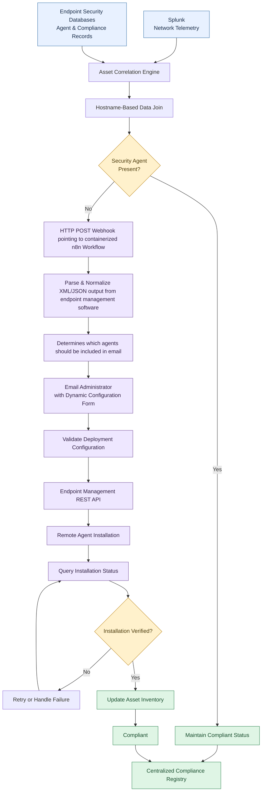
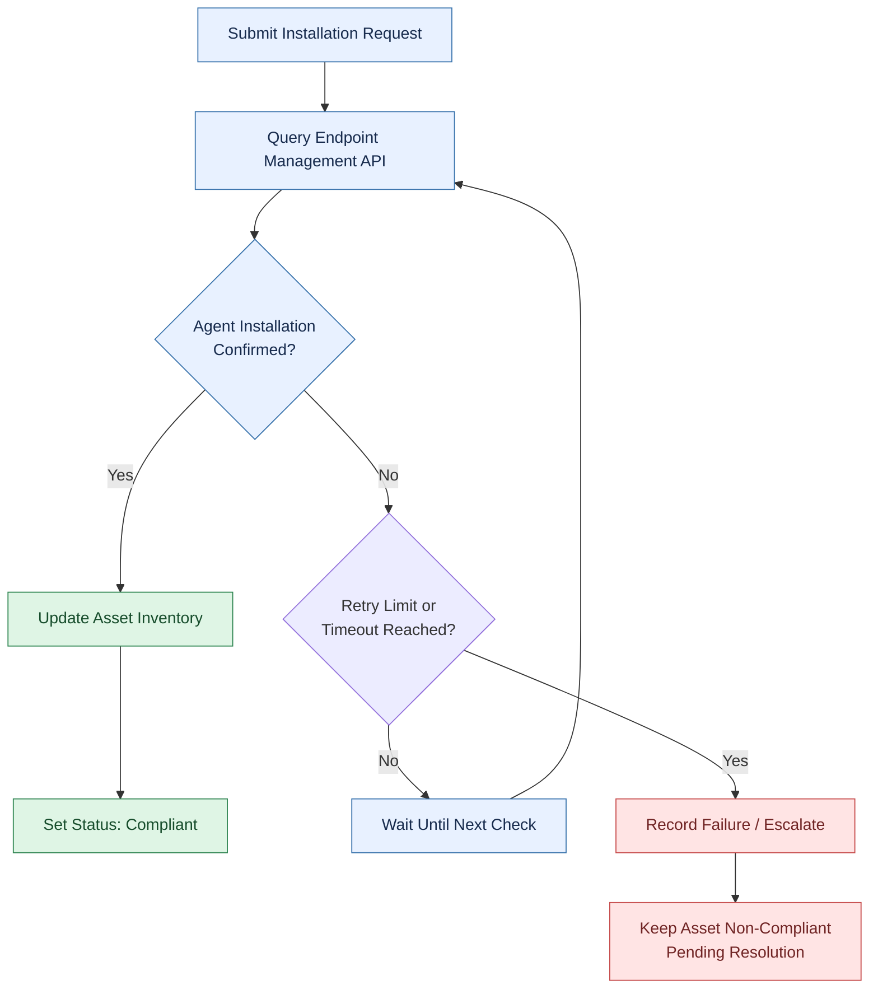

# C2C-Pipeline
Comply to Connect pipeline design structure and overview

# Automated Endpoint Compliance & Remediation Pipeline

An automated, closed-loop endpoint compliance solution integrating **Splunk, n8n, and REST APIs** to identify unmanaged devices, coordinate endpoint agent deployment, and continuously validate remediation.

## Overview

This project ensures that active devices across the environment complied with established security baselines. Network telemetry was collected in **Splunk**, while endpoint security tools maintained separate records of agent deployment and device compliance.

Manually correlating millions of log events with endpoint security records was inefficient and made it difficult to identify unmanaged or non-compliant machines before they became security risks.

I developed a data-driven automation approach to streamline asset discovery, coordinate endpoint agent installation, and verify successful remediation without requiring IT personnel to manually initiate each deployment.

The solution combined data correlation, custom JSON parsing, workflow automation, administrator approval, and continuous API-based validation.

## Architecture

The pipeline connects security telemetry, asset correlation, workflow orchestration, endpoint management, and compliance verification into a single remediation process.

## How It Works

### 1. Data Ingestion & Asset Correlation

I queried **Splunk network telemetry** to identify active machines and cross-referenced the results with endpoint security tool databases.

* Retrieved network activity associated with active devices.
* Used hostnames as unique correlation keys across datasets.
* Joined telemetry records with endpoint agent and compliance records.
* Isolated active devices that lacked the required security agents.

This transformed large volumes of raw telemetry into an actionable list of potentially non-compliant assets.

### 2. Automated Data Processing with n8n

Once a non-compliant device was identified, its data was passed into an **n8n workflow** for automated processing.

The workflow included custom logic to:

* Parse raw JSON payloads.
* Extract relevant network and routing attributes.
* Normalize field names and data structures.
* Validate and transform data into the schema expected by the endpoint management platform.
* Pass the resulting deployment payload to subsequent workflow steps.

This data transformation layer allowed information from disparate security systems to be used consistently throughout the remediation process.

### 3. Administrator Notification & Configuration

The workflow generated an automated email containing a dynamic configuration form for the responsible system administrator.

The administrator could select the appropriate deployment configuration for the target device. The workflow then validated the selected configuration before initiating the next stage.

This introduced a human approval and configuration step while eliminating the need for administrators to manually coordinate the entire deployment process.

### 4. API-Driven Endpoint Remediation

After the configuration was selected, n8n interacted with the **endpoint management platform through its REST API** to initiate remote security agent installation.

The workflow handled the deployment request programmatically rather than requiring an IT technician to manually initiate installation on each machine.

Key capabilities included:

* API-based deployment requests.
* Structured request payloads.
* Automated workflow orchestration.
* Deployment status tracking.
* Failure handling and revalidation.

### 5. Continuous Validation & Compliance Tracking

Initiating an installation was not sufficient to establish compliance. The system needed to verify that the agent was actually installed and operational.

I implemented a validation loop that repeatedly queried installation status through the endpoint management API until the deployment outcome could be determined.

The validation process ensured that asset records reflected verified deployment outcomes rather than simply recording that an installation request had been submitted.

In a production implementation, retry limits, timeouts, API errors, and escalation paths prevent failed deployments from remaining in an indefinite polling loop.

## Technology Stack

| Technology                       | Role                                                                      |
| -------------------------------- | ------------------------------------------------------------------------- |
| **Splunk**                       | Network telemetry queries and active-device discovery                     |
| **n8n**                          | Workflow orchestration and automated remediation                          |
| **JSON**                         | Structured data extraction, transformation, and payload normalization     |
| **REST APIs**                    | Integration with endpoint management and installation-status verification |
| **Email & Dynamic Forms**        | Administrator notification and deployment configuration                   |
| **Endpoint Management Platform** | Remote security agent deployment and installation status                  |
| **Asset Inventory**              | Centralized compliance status tracking                                    |

## Security & Reliability Considerations

The workflow was designed around the principle that remediation should be verified before an asset is marked compliant.

* **Data correlation:** Use consistent asset identifiers and validate records before initiating remediation.
* **Controlled deployment:** Require the appropriate administrator configuration and authorization.
* **API security:** Protect credentials and use least-privilege service accounts.
* **Input validation:** Validate JSON fields and reject malformed or unexpected payloads.
* **Failure handling:** Account for API errors, timeouts, installation failures, and retry limits.
* **Auditability:** Track deployment requests, administrator decisions, verification results, and inventory updates.
* **Accurate compliance reporting:** Mark a device compliant only after successful installation has been verified.

## Results & Impact

The automation shifted endpoint compliance from a manual auditing process toward a proactive, repeatable remediation workflow.

* **Reduced manual effort:** Automated device correlation, notification, deployment coordination, and verification.
* **Faster remediation:** Reduced the number of manual steps between detecting a compliance gap and initiating corrective action.
* **Improved visibility:** Connected network activity, endpoint agent status, and asset inventory records.
* **Closed-loop verification:** Confirmed deployment outcomes through API-based status checks.
* **More consistent reporting:** Updated compliance status based on verified remediation results.
* **Reduced exposure window:** Helped identify and address devices missing required security agents.

## Key Takeaway

This project demonstrated how security telemetry, data engineering, and workflow automation can work together to improve endpoint compliance.

By combining Splunk-based asset discovery with n8n orchestration and REST API-driven remediation, I developed an approach for turning fragmented security data into actionable remediation workflows with continuous validation.

The core principle is simple: **identify the gap, automate the remediation, verify the result, and update compliance only when the outcome is confirmed.**

---
